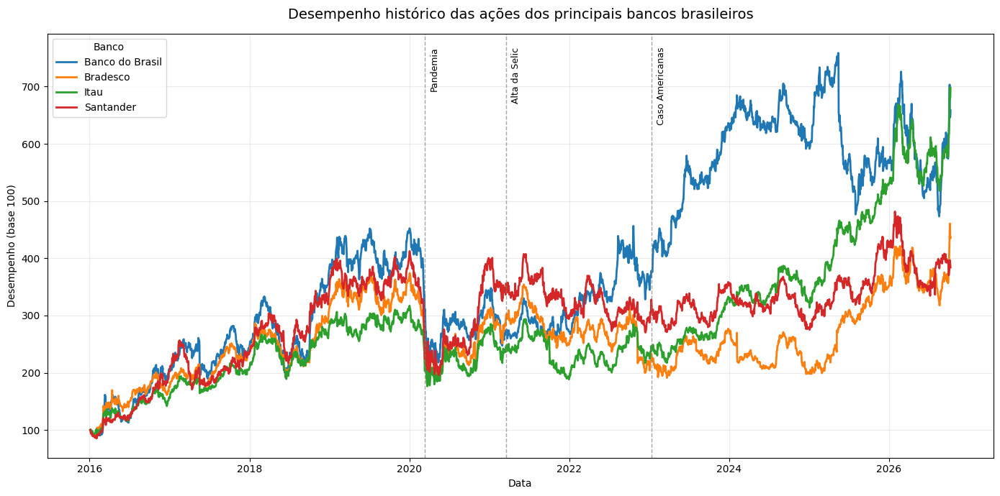

# Análise do Desempenho de Bancos Brasileiros

## Objetivo

Comparar o desempenho histórico das ações de quatro bancos brasileiros — Itaú, Bradesco, Santander e Banco do Brasil — utilizando Python e ferramentas de análise de dados financeiros.

O projeto busca avaliar o comportamento dos ativos ao longo do tempo, considerando o desempenho acumulado, indicadores de risco e a relação com o mercado acionário brasileiro.

## Ativos analisados

- Itaú: ITUB4.SA
- Bradesco: BBDC4.SA
- Santander: SANB11.SA
- Banco do Brasil: BBAS3.SA

## Estrutura do projeto

O projeto está dividido em duas versões complementares:

- **Versão 1.0:** análise histórica do desempenho das ações, com construção de um índice de desempenho com base 100 e visualização gráfica.
- **Versão 2.0:** ampliação da análise, incorporando indicadores de retorno, risco e correlação com o Ibovespa.

**Notebooks:**
- [Versão 1.0 – Análise inicial](bancos.ipynb)
- [Versão 2.0 – Análise de retorno e risco](bancos_v2/bancos_v2.ipynb)

## Versão 1.0 – Desempenho histórico

A primeira versão utiliza dados históricos das ações para construir um índice de desempenho com base 100, permitindo comparar a evolução dos ativos mesmo quando seus preços iniciais são diferentes.

O gráfico também destaca três referências históricas:

- Pandemia de COVID-19;
- Início do ciclo de alta da Selic em 2021;
- Caso Americanas em 2023.

Essas marcações oferecem contexto para a análise, sem pressupor uma relação causal direta com os movimentos dos preços.

## Versão 2.0 – Análise de retorno e risco

A segunda versão amplia o escopo do projeto, incorporando métricas quantitativas para avaliar o desempenho e o risco dos ativos.

Foram desenvolvidas as seguintes análises:

- **Retorno acumulado:** variação percentual acumulada das ações no período analisado.
- **Volatilidade anualizada:** medida da dispersão dos retornos diários, anualizada considerando 252 pregões.
- **Maximum Drawdown:** maior queda percentual de cada ativo em relação ao seu pico histórico anterior.
- **Correlação com o Ibovespa:** avaliação da relação entre os retornos diários das ações e os retornos do principal índice da bolsa brasileira.

Também foi desenvolvida uma comparação gráfica do desempenho acumulado dos bancos com o Ibovespa.

### Resultados da análise

Resultados obtidos na execução da versão 2.0:

| Banco | Retorno acumulado | Volatilidade anualizada | Maximum Drawdown | Correlação com Ibovespa |
|---|---:|---:|---:|---:|
| Itaú | 446,52% | 30,04% | -44,34% | 0,80 |
| Banco do Brasil | 339,71% | 39,13% | -58,29% | 0,78 |
| Santander | 233,10% | 32,95% | -52,51% | 0,73 |
| Bradesco | 191,01% | 35,08% | -52,77% | 0,80 |

Na execução apresentada, o Itaú registrou o maior retorno acumulado e a menor volatilidade e perda máxima entre os quatro bancos analisados. O Banco do Brasil apresentou o segundo maior retorno, acompanhado dos maiores níveis de volatilidade e drawdown.

Os resultados são históricos, podem variar conforme a atualização dos dados e não representam previsões ou recomendações de investimento.

## Metodologia e fonte dos dados

Os dados históricos são obtidos por meio da biblioteca `yfinance`, que acessa informações disponibilizadas pelo Yahoo Finance.

O período analisado começa em janeiro de 2016. Na versão 2.0, são utilizados preços históricos ajustados (`auto_adjust=True`) para o cálculo dos retornos das ações.

Os retornos diários são calculados a partir da variação percentual dos preços, servindo de base para as métricas de volatilidade e correlação.

O Ibovespa é utilizado como referência para a comparação com o mercado acionário brasileiro.

**Observação metodológica:** os preços ajustados das ações incorporam ajustes relacionados a proventos e eventos corporativos. Já o Ibovespa convencional é um índice de preços, sem reinvestimento de dividendos. Portanto, a comparação direta dos retornos acumulados entre as ações e o índice deve ser interpretada com essa ressalva.

## Ferramentas e bibliotecas

- Python
- pandas
- NumPy
- yfinance
- Matplotlib

## Limitações

- O desempenho passado não garante resultados futuros.
- A análise não substitui uma avaliação fundamentalista das instituições.
- Os indicadores estatísticos não capturam todos os fatores que influenciam os preços das ações.
- A correlação observada não implica causalidade.
- A comparação de retorno acumulado com o Ibovespa possui a ressalva metodológica referente ao tratamento dos dividendos.

## Finalidade

Projeto educacional desenvolvido para aprimorar conhecimentos em programação, coleta e tratamento de dados financeiros, análise quantitativa, visualização de dados e avaliação de ativos do mercado de capitais.

O desenvolvimento das duas versões permitiu aplicar conceitos de retorno, risco, volatilidade, drawdown e correlação a um problema prático de análise de investimentos.

## Gráfico de desempenho

